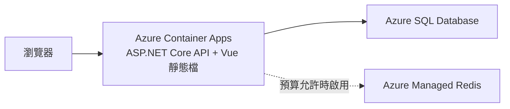

# Azure 部署與成本規劃

核對日期：2026-10-15。此文件是選型規劃，尚未建立 Azure 資源、核定月費上限或驗證實際帳單。價格與可用區域在部署課重新確認。

## 展示環境

前端與 API 放在同一個部署，讓 Cookie 登入維持同源，減少跨站設定。第一版先使用 Azure 提供的 HTTPS 網址，不必購買網域。

本機則由 Docker Compose 提供 SQL Server 與 Redis，API 可在主機執行以方便除錯；需要驗證容器或多實例時，再把 API 加進 Compose。

## 服務選型

| 用途 | 選擇 | 採用理由 |
|---|---|---|
| 應用部署 | Container Apps Consumption | 能部署標準容器，按需要擴縮，適合低流量作品 |
| 關聯資料庫 | Azure SQL Database | 與本機 SQL Server / EF Core 接近，提供託管備份與維護 |
| 快取實驗 | 本機 Redis；託管實驗採 Azure Managed Redis | 先學實際快取行為，再依預算練習雲端連線與管理 |
| 映像與自動化 | GitHub Container Registry、GitHub Actions | 與公開程式碼整合；發布前確認映像可見性、儲存與執行額度 |
| 觀察 | Container Apps 日誌與 Azure 指標；按需要啟用 Application Insights | 先收集足以查錯的資料，避免高量日誌長期累積 |

Azure Cache for Redis 已公布退場時程，新專案的託管快取課程採 Azure Managed Redis。產品名稱、區域與方案仍需在建立當天再次核對。

Static Web Apps Free 可用於日後的獨立介紹頁，但第一版不是必要依賴。採同源部署是為了降低登入與部署複雜度。

## 先分清三種成本

1. 本機學習：SQL Server 使用適用於開發測試的授權／映像，Redis 本機執行；不是公開正式服務的授權配置。
2. 長期展示：只保留面試官操作需要的資源與小量資料，Redis 可停用，直接查資料庫。
3. 短期實驗：多實例、託管 Redis 等資源，先估價與設定結束時間，完成後驗證已移除。

雲端停用 Redis 時，作品文件須標示差異；可以展示本機實測與設定方式，但不宣稱網站正在使用託管 Redis。

## 免費額度與限制

- Container Apps Consumption 每個訂用帳戶每月有 180,000 vCPU-seconds、360,000 GiB-seconds 與 200 萬次 HTTP 請求免費額度；不是任意配置都能免費。
- `minReplicas=0` 沒有執行中副本時不收運算費，但首次請求要等啟動；若改為常駐副本，須重新估價。
- Azure SQL 免費方案每個資料庫每月提供 100,000 vCore-seconds、32 GB 資料與 32 GB 備份額度；達上限可暫停至下月，或選擇付費繼續使用。
- 免費 SQL 的休眠恢復與應用冷啟動可能一起增加首次等待。展示前實測，API 使用有限次數連線重試，畫面提供載入與可重試狀態。
- 月費還可能來自資料庫、日誌、網路流量、映像儲存及其他額外功能，不以 API 免費額度推算整站免費。

## 建立資源前的決策

由學員看過估價後決定：

- 省費優先：API 可縮到零、SQL 評估免費方案，接受首次等待與額度限制。
- 展示優先：評估 API 常駐與小型付費 SQL，實測體驗後決定是否保留。

月費上限仍待學員決定，不能把先前討論用的價格區間當成已核定預算。

估價必須列出訂用帳戶、區域、CPU / 記憶體、副本上限、資料庫方案、日誌與儲存，並記錄預估與實際用量。預算通知是告警，不是自動停費開關；副本數上限也不是帳單上限。

## 發布與維運驗收

- C07 先以小型設定手動部署，理解資源用途；C11 再用 Bicep 與 GitHub Actions 重現。
- 秘密放在服務秘密設定；C11 學 OIDC 部署身分，並在 Azure SQL 連線課比較密碼與 Managed Identity。
- 發布前跑 Migration，避免每個 API 副本在啟動時同時修改結構；變更保持與舊版本相容。
- 公開環境停用開發固定身分，展示帳號只能操作虛構展示資料，沒有管理權限。
- 負載測試在本機或短期實驗環境進行；免費展示資料庫只做低量功能驗收。
- 演練停止應用、資料庫無法連線與 Redis 中斷，確認錯誤可追查且重試有上限。
- 記錄可觀察期間的帳單、冷熱啟動差異、展示資料維護與還原步驟。
- 不以定時外部請求保活，避免意外增加應用與資料庫用量。

## 官方來源

- [Container Apps 計費與免費額度](https://learn.microsoft.com/en-us/azure/container-apps/billing)
- [Azure SQL 免費方案與額度用盡行為](https://learn.microsoft.com/en-us/azure/azure-sql/database/free-offer?view=azuresql)
- [Azure SQL 方案與定價入口](https://azure.microsoft.com/en-us/pricing/details/azure-sql-database/single/)
- [Azure Cache for Redis 退場 FAQ](https://learn.microsoft.com/en-us/azure/azure-cache-for-redis/retirement-faq)
- [Static Web Apps 方案](https://learn.microsoft.com/en-us/azure/static-web-apps/plans)
- [Azure Pricing Calculator](https://azure.microsoft.com/en-us/pricing/calculator/)
